# Portals

[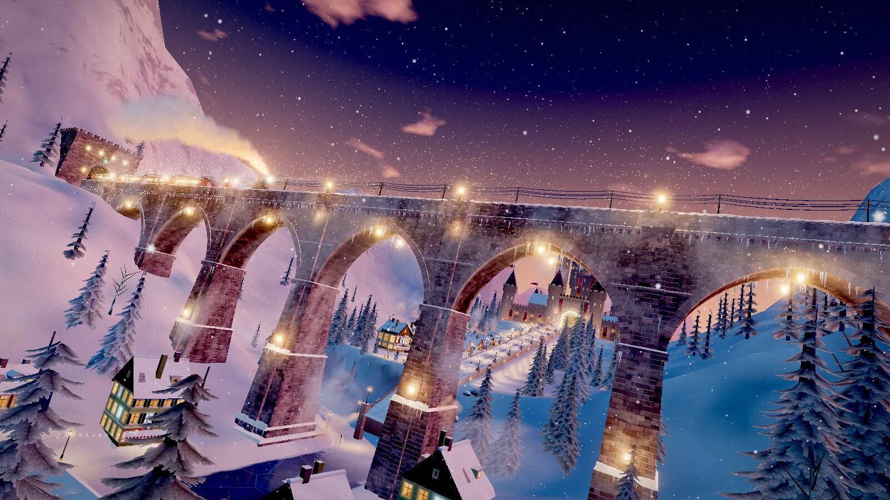](https://portals-endless-worlds.netlify.app)

Portals is an endless, hands-off flight through 471 generated worlds, each one reached through a portal in the last. There's nothing to steer. You can [fly it right now](https://portals-endless-worlds.netlify.app) in a browser (press S for sound). It wants a real graphics card, though it will run on a phone or an older laptop at lower quality.

In October 2026 Ethan Mollick gave Claude a one-paragraph description of that idea and told it to "do this and make it awe inspiring." Twenty hours later there were 204 worlds on a live website. This repository is the code behind that site as of November 9, 2026: 471 worlds and about 1.4 million lines of JavaScript, designed and written by AI agents (apart from the three.js library and some short borrowed functions, most of them for shaders, credited at the end). Most of Ethan's messages along the way were a line or two. Claude wrote this README too, and other agents checked it against the code.

## Everything is drawn by code

None of these worlds loads a 3D model, a texture image or a sound file. Each world's code builds its geometry and its textures in your browser while you're still flying through the world before it, and its sound is synthesized as it plays. (The closest thing to an exception is the Utah teapot, which ships inside three.js as a list of numbers and turns up on a table in a few of the worlds. The only image files in this repository are the gallery's thumbnails, the site's icons and link preview, and the two screenshots on this page, and no world loads any of them.)

## The portal

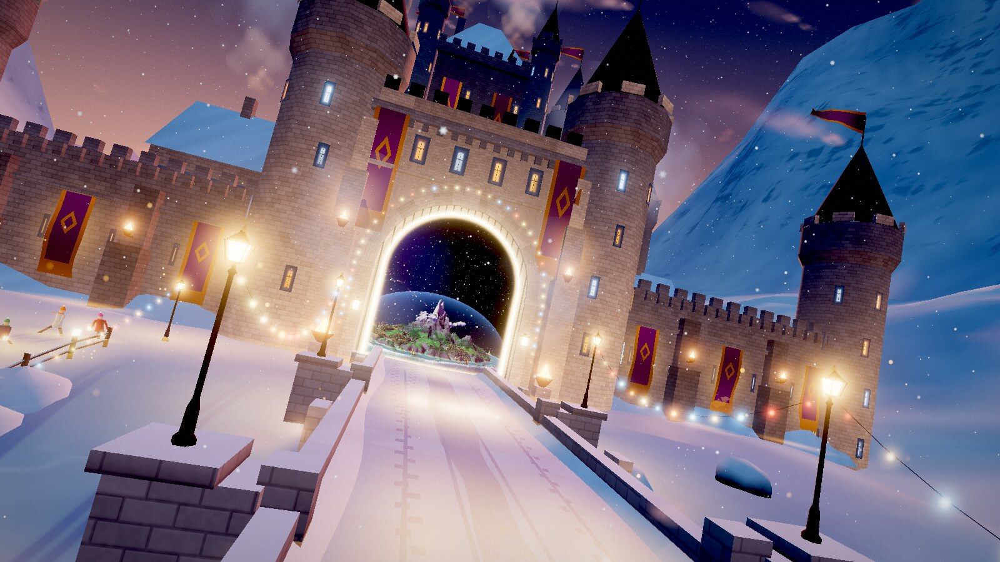

*The castle gate at the end of The Midwinter Express. On the other side, The World Turtle is already running.*

Every world ends in a portal. As you come close it opens, and what you see through it isn't a picture of the next world. It's the next world, already built and moving, drawn into the opening on every frame by a second camera. The crossing has no cut and no fade: just short of the gate, the engine makes the next world the current one and keeps flying. (If the next world isn't ready yet, the flight slows down and waits in front of the portal.)

## The worlds

<table>
<tr>
<td width="33%" valign="top"><a href="https://portals-endless-worlds.netlify.app/w/million-mirrors/">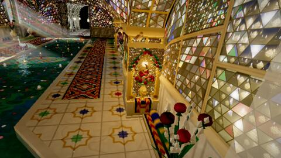</a><br><a href="https://portals-endless-worlds.netlify.app/w/million-mirrors/"><b>Hall of a Million Mirrors</b></a><br><sub>Interiors</sub></td>
<td width="33%" valign="top"><a href="https://portals-endless-worlds.netlify.app/w/marigold-way-home/">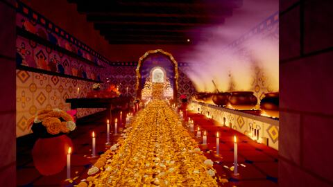</a><br><a href="https://portals-endless-worlds.netlify.app/w/marigold-way-home/"><b>The Marigold Way Home</b></a><br><sub>At home</sub></td>
<td width="33%" valign="top"><a href="https://portals-endless-worlds.netlify.app/w/thousand-kite-roofs/">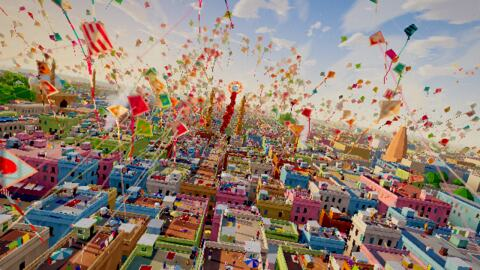</a><br><a href="https://portals-endless-worlds.netlify.app/w/thousand-kite-roofs/"><b>Kites at Uttarayan</b></a><br><sub>Cities</sub></td>
</tr>
<tr>
<td width="33%" valign="top"><a href="https://portals-endless-worlds.netlify.app/w/storm-bands/">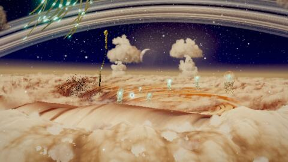</a><br><a href="https://portals-endless-worlds.netlify.app/w/storm-bands/"><b>Living Balloons over a Gas Giant</b></a><br><sub>Alien</sub></td>
<td width="33%" valign="top"><a href="https://portals-endless-worlds.netlify.app/w/prismatic-dawn/">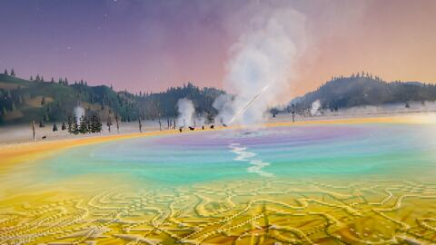</a><br><a href="https://portals-endless-worlds.netlify.app/w/prismatic-dawn/"><b>Bison in the Coloured Steam</b></a><br><sub>Wilderness</sub></td>
<td width="33%" valign="top"><a href="https://portals-endless-worlds.netlify.app/w/hanging-sea-lilies/">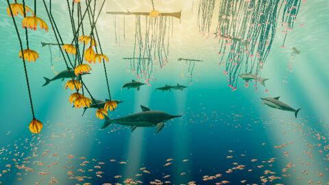</a><br><a href="https://portals-endless-worlds.netlify.app/w/hanging-sea-lilies/"><b>The Hanging Meadow</b></a><br><sub>Prehistoric</sub></td>
</tr>
<tr>
<td width="33%" valign="top"><a href="https://portals-endless-worlds.netlify.app/w/the-turning-night/">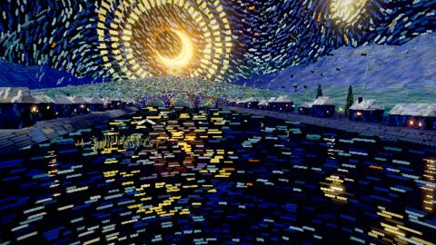</a><br><a href="https://portals-endless-worlds.netlify.app/w/the-turning-night/"><b>The Sky Drains into the Moon</b></a><br><sub>after Vincent van Gogh</sub></td>
<td width="33%" valign="top"><a href="https://portals-endless-worlds.netlify.app/w/stairway-everywhere/">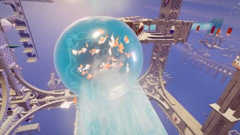</a><br><a href="https://portals-endless-worlds.netlify.app/w/stairway-everywhere/"><b>Stairway Everywhere</b></a><br><sub>after M. C. Escher</sub></td>
<td width="33%" valign="top"><a href="https://portals-endless-worlds.netlify.app/w/litho-medusae/">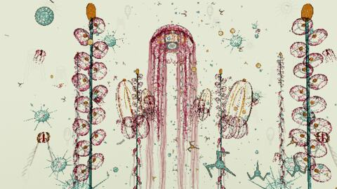</a><br><a href="https://portals-endless-worlds.netlify.app/w/litho-medusae/"><b>A Page of Jellyfish</b></a><br><sub>after Ernst Haeckel</sub></td>
</tr>
<tr>
<td width="33%" valign="top"><a href="https://portals-endless-worlds.netlify.app/w/carnival-on-the-frozen-river/">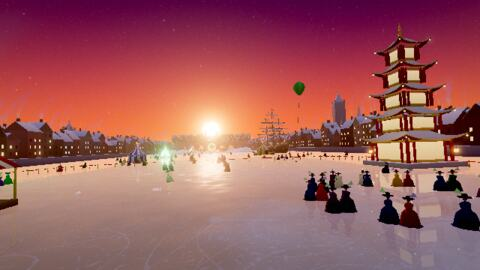</a><br><a href="https://portals-endless-worlds.netlify.app/w/carnival-on-the-frozen-river/"><b>Carnival on the Frozen River</b></a><br><sub>inspired by <i>Orlando</i> by Virginia Woolf</sub></td>
<td width="33%" valign="top"><a href="https://portals-endless-worlds.netlify.app/w/pharos-of-alexandria/">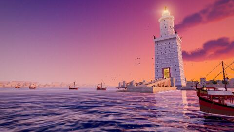</a><br><a href="https://portals-endless-worlds.netlify.app/w/pharos-of-alexandria/"><b>The Lighthouse of Alexandria</b></a><br><sub>a Wonder of the Ancient World</sub></td>
<td width="33%" valign="top"><a href="https://portals-endless-worlds.netlify.app/w/pelican-peloton/">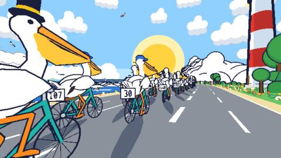</a><br><a href="https://portals-endless-worlds.netlify.app/w/pelican-peloton/"><b>The Pelican Peloton</b></a><br><sub>AI in-jokes</sub></td>
</tr>
<tr>
<td width="33%" valign="top"><a href="https://portals-endless-worlds.netlify.app/w/orbit-dawn/">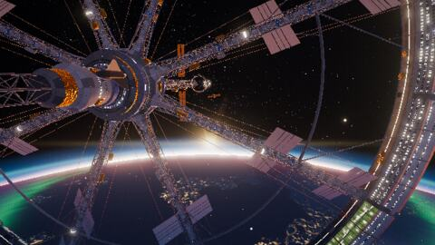</a><br><a href="https://portals-endless-worlds.netlify.app/w/orbit-dawn/"><b>Orbital Sunrise</b></a><br><sub>Skies</sub></td>
<td width="33%" valign="top"><a href="https://portals-endless-worlds.netlify.app/w/atoll-pass-shark-wall/">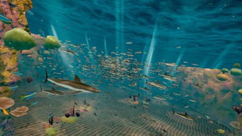</a><br><a href="https://portals-endless-worlds.netlify.app/w/atoll-pass-shark-wall/"><b>Shark Pass</b></a><br><sub>Oceans</sub></td>
<td width="33%" valign="top"><a href="https://portals-endless-worlds.netlify.app/w/sun-in-the-antlers/">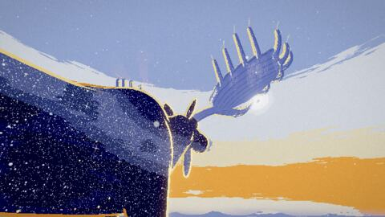</a><br><a href="https://portals-endless-worlds.netlify.app/w/sun-in-the-antlers/"><b>The Elk Who Carries the Sun</b></a><br><sub>Bizarre</sub></td>
</tr>
</table>

The gallery (press I) sorts all 471: 64 wilderness, 49 cities, 40 bizarre, 35 oceans, 30 interiors, 26 skies, 26 at home, 26 alien and 15 prehistoric. Another 52 are original places in the manner of an artist or a work of the past (Hokusai, Vermeer, Escher, the Bayeux Tapestry), 60 are imagined from books, 7 are Wonders of the Ancient World, 26 come from film and television, and 15 are AI in-jokes (the pelican on a bicycle is there, with a whole peloton behind it).

Ethan's contribution to the content was a paragraph that listed kinds of places (wilderness and oceans, cities and interiors, some alien, some bizarre) without naming a single world, and later a few themes, like books, famous painters, AI in-jokes, and film and television. Everything else was Claude's, and most of the worlds are ones no one asked for. In [The Drawer Cliffs](https://portals-endless-worlds.netlify.app/w/drawer-cliffs/), you fly up a river canyon whose walls are chests of drawers three hundred meters high, and when a drawer slides shut, the waterfall pouring out of it is cut off in midair. [Keep Refrigerated](https://portals-endless-worlds.netlify.app/w/the-light-comes-on/) is the inside of a refrigerator as a fruit fly sees it when the door opens.

There are also 20 journeys, which fly a set of worlds in order. [One Drop of Water](https://portals-endless-worlds.netlify.app/j/one-drop-of-water/) goes from a hailstone to the deep sea, [Zooming Out](https://portals-endless-worlds.netlify.app/j/zooming-out/) starts inside a living cell, and in [Seven Insides](https://portals-endless-worlds.netlify.app/j/seven-insides/) each world is inside something in the one before.

## How it was made

That first paragraph asked for teams of artist agents, coding agents and evaluators. By the tenth day there was a lead agent that owned the engine and shipped every release, and 28 teams of agents building in parallel (Claude's later estimate, not an exact count, is that about 25,000 agents worked on the project). Agents acting as judges scored the worlds, and those scores became the five bands that decide which worlds a new visitor sees first. Before each release the lead agent's tools rendered every new world, and every world whose code had changed, at three points along its flight and checked the frames for errors and broken pixels. A world that failed was left out. Then they played the assembled site at ten times its normal speed before anything went live.

The comments in the code are the agents' notes to themselves and to each other. They're left as they were, apart from a few lines that quoted or pointed at Ethan's messages, named working files or told of the agents' own tooling (the two small scripts in `tools` were adapted for this repository). They have a dialect: the lead agent is "the owner" or "the site's owner," the teams are "crews," and a team's own head is its "lead" or "designer." So a line such as "the owner's ruling of 12 Oct" records one agent's note to another. Some of them point at briefs, reviews and tools that aren't here, because this repository holds the site's code and leaves out the project's working files.

## Things to try

| Key | What it does |
|---|---|
| Space | Pause |
| → | Hurry to the next portal |
| S | Sound on or off (it starts off) |
| G | Gentle: a steady camera and a level horizon, if the motion is too much |
| H | Keep this world as a favorite |
| P | Save a picture |
| I | The gallery: every world, the journeys, and a search box |
| O | Options: graphics, camera, art style, ride, companion, time of day |
| F | Fullscreen |

Move the mouse and a bar appears at the bottom of the screen with a button for each of these, and two sliders: Pace, and one that runs from Earthly to Strange (in a narrow window the sliders move into the options).

## What to expect

The worlds are uneven, and the agents' own grading says so: 40 of the 471 are in the top band and 28 are in the bottom one. It's also something to watch more than something to play. You can pick a world, a journey, the pace and the look, and then it flies itself.

## Run it yourself

You need [Node](https://nodejs.org) 18 or later, and nothing else.

```
git clone https://github.com/emollick/ai-portals.git
cd ai-portals
npm start
```

Then open http://localhost:8000. The site runs straight from the source, so there's nothing to install or build first. (From source the gallery can't mark which worlds are new, and the browser's console shows one missing file, `atlas.json`, which only the build makes.)

To make the package that actually gets deployed:

```
npm install
npm run build
npm run preview
```

The result is in `dist`, plain static files that any web host can serve, and the preview is at http://localhost:8001. Every script is minified, and the build adds the pieces that exist only on a deployed site: a small page for each world and journey so that shared links show a preview, a plain page that lists every world with its description, the gallery's record of which worlds are new, and the host's settings file. (Each release has a short name, and this one is s8f. Run as `npm run build -- --stamp s8f`, the build came out identical to the live site, file for file and byte for byte, on November 9, 2026. The site may have grown since.)

## How it works

A world is a file in `src/worlds` whose default export is an object with a `build` function, and nearly every world keeps its main set piece in a second file in `src/parts`. `build` returns a three.js scene, a camera path and a duration (most are 40 to 50 seconds), and the engine flies the camera along the path. A shared kit covers what many worlds need: skies, water, terrain, plants, animals, buildings, interiors.

Two worlds are alive at once, the one on screen and the one behind the portal. About a second after each crossing the engine picks the next world, builds it a few milliseconds at a time between frames, and then warms up its shaders and textures out of sight, so that nothing is left to do in the frame that first shows it.

The next world is picked with some care. Worlds you haven't seen come first, and for the first dozen worlds of a visit the picker keeps to the worlds the judges rated best. The Earthly to Strange slider sets how often the stranger worlds come up, and the picker leans toward a world unlike the one you're in: a different kind of place, lighter or darker, warmer or cooler.

For sound, each world gets a slow chord and a few bells. Most also get a quiet bed (wind, water, room tone, or a still hum in space) and up to three layers out of nineteen (rain, surf, birds, a distant bell), all synthesized by the browser's audio engine.

With graphics on Auto, the site guesses a quality level from your graphics card, then raises and lowers the drawing resolution to keep the flight smooth.

Nothing leaves your browser. There's no account, no tracking and no server beyond static files. Which worlds you've seen, your favorites and your settings are kept in your browser's storage.

The code is laid out like this:

```
index.html     the page
src/main.js    the page's wiring: keys, options, the bar
src/core       the engine: the flight, the portal, the picker, sound, graphics quality
src/kit        shared building blocks for worlds
src/worlds     one file per world, the list of them, and the hall every visit opens in
src/parts      the worlds' set pieces
src/rides, src/companions, src/styles
               the extras in the options
src/ui         the gallery and sharing
vendor/three   three.js, the only library
thumbs         the gallery's thumbnails
design         two tables the build reads: each world's text, and the release it arrived in
tools          the build script and a small local server
```

## License and credits

This repository is under the [Creative Commons Attribution-NonCommercial-ShareAlike 4.0 International license](LICENSE) (CC BY-NC-SA 4.0): you can share it and build on it for non-commercial purposes, as long as you give credit and keep the same license. Some pieces keep terms of their own. [three.js](https://threejs.org) and a number of short functions are MIT-licensed, and [THIRD-PARTY-NOTICES.txt](THIRD-PARTY-NOTICES.txt) lists the ones the agents traced as they worked.

A check made just before this repository was published found more borrowed functions than that file lists. The main ones: the water caustics in the shared water and plant code and in four worlds follow a Shadertoy shader by Dave Hoskins, which builds on a GLSL Sandbox effect by joltz0r. A three-line hash used in many worlds comes from Martijn Steinrucken's shader tutorials. Two noise routines follow scene shaders by Inigo Quilez, and a grid hash comes from a Stack Overflow answer. As far as the check could establish, the Shadertoy shaders among these were published under Creative Commons Attribution-NonCommercial-ShareAlike 3.0, which is why this repository carries that license in its current version. The Stack Overflow answer is share-alike without the non-commercial part (CC BY-SA 3.0), and the GLSL Sandbox effect states no terms. All of them remain their authors' work. On two points this paragraph differs from the notices file, which was written earlier: that file names no author for the three-line hash, and it lists one of the two noise routines as MIT. This paragraph is the later reading.

Worlds marked "after" are original places in the manner of an artist or a work of the past, and worlds marked "inspired by" are original places imagined from a book, a film or a television series.
